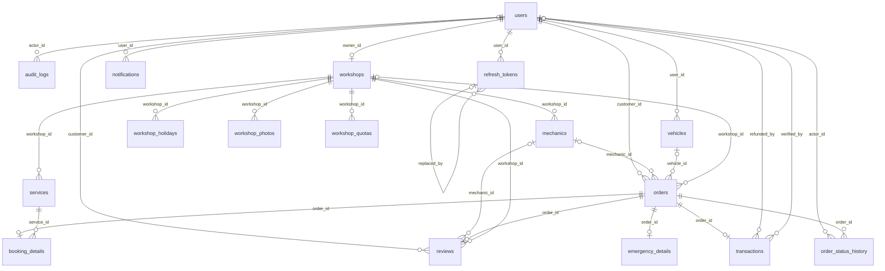
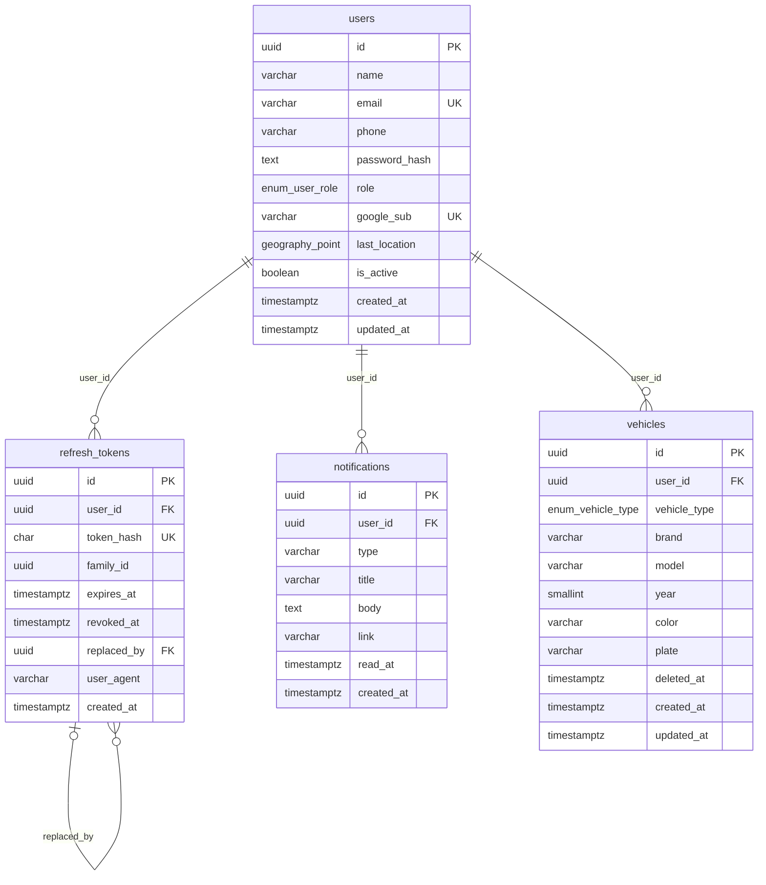
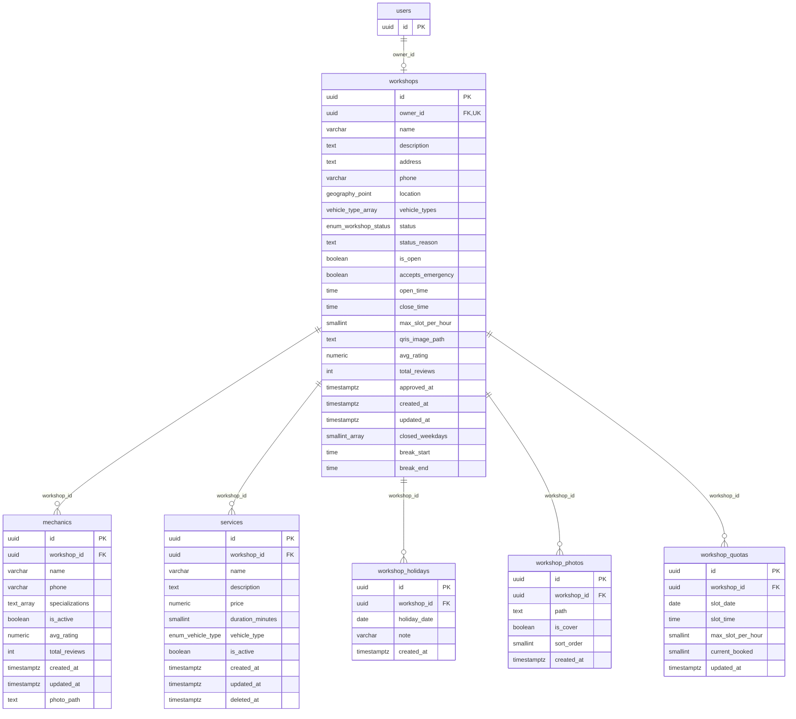
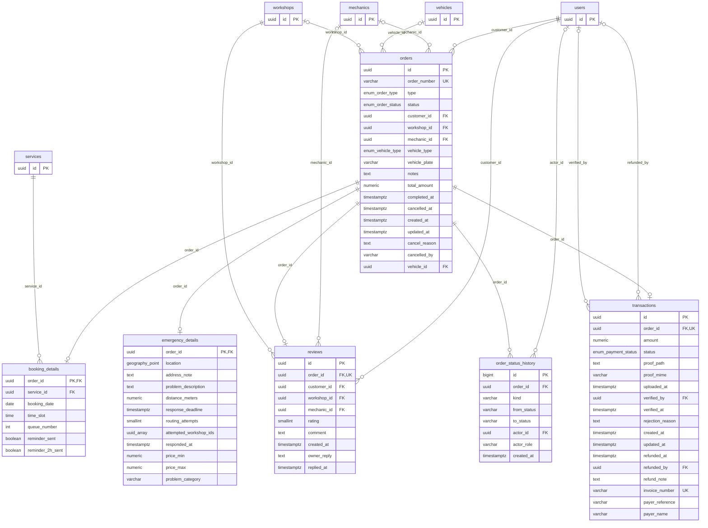
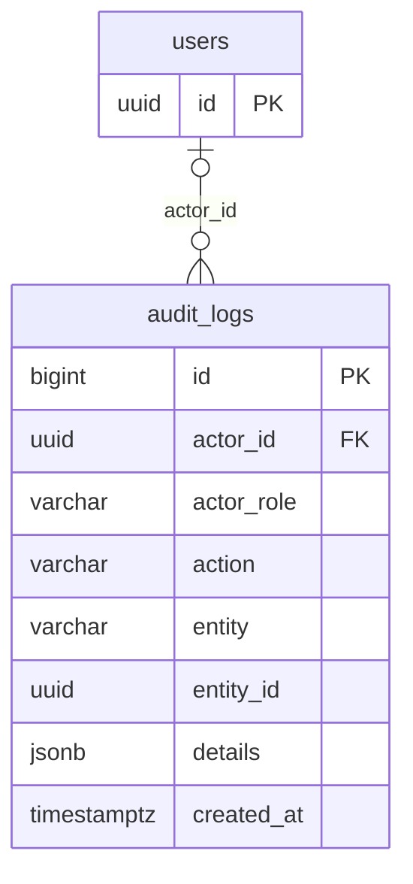

# ERD Database BengkelGo

Dibuat otomatis dari skema database yang berjalan (`backend/scripts/erd/build-erd.py`). 17 tabel, 27 relasi. Migrasi: `001_init` s/d `005_reminder_2h`.

Versi teks untuk **QuickDBD** (app.quickdatabasediagrams.com): [erd-quickdbd.txt](erd-quickdbd.txt), dibuat dengan `backend/scripts/erd/build-quickdbd.py` dari ekspor kolom (dengan `column_default`), relasi, dan enum database lokal.

Cara baca garis: `||` tepat satu, `|o` nol atau satu, `o{` nol atau banyak. Label garis = kolom foreign key.

## Gambaran relasi

## Akun & pelanggan

Pengguna semua peran, sesi login, notifikasi, dan kendaraan tersimpan.

| Tabel | Isi |
|---|---|
| `users` | Semua peran: CUSTOMER, GUEST, WORKSHOP_OWNER, ADMIN. |
| `refresh_tokens` | Hanya hash SHA-256 yang disimpan; satu family dicabut bila token dipakai ulang. |
| `notifications` | Notifikasi di dalam aplikasi per pengguna. *(baru, migrasi 004)* |
| `vehicles` | Kendaraan tersimpan pelanggan (soft delete). *(baru, migrasi 004)* |

## Bengkel

Profil bengkel mitra beserta layanan, mekanik, kuota per jam, hari libur, dan foto.

| Tabel | Isi |
|---|---|
| `workshops` | Satu bengkel per pemilik; lokasi PostGIS untuk radius 5 km. |
| `services` | Layanan dengan harga dan durasi (soft delete). |
| `mechanics` | Mekanik dengan rating dan tag keahlian. |
| `workshop_quotas` | Kapasitas per jam, dikunci FOR UPDATE saat booking. |
| `workshop_holidays` | Tanggal libur bengkel. *(baru, migrasi 004)* |
| `workshop_photos` | Galeri foto; satu foto sampul per bengkel. *(baru, migrasi 004)* |

## Pesanan & pembayaran

Satu pesanan (booking atau SOS) dengan detailnya, pembayaran QRIS, ulasan, dan riwayat status.

| Tabel | Isi |
|---|---|
| `orders` | Pesanan booking atau SOS. |
| `booking_details` | Tanggal, jam, dan nomor antrean booking. |
| `emergency_details` | Lokasi, keluhan, dan routing SOS. |
| `transactions` | Pembayaran QRIS satu pesanan: bukti, verifikasi, invoice, refund. |
| `reviews` | Satu ulasan per pesanan selesai, dengan balasan bengkel. |
| `order_status_history` | Diisi otomatis oleh trigger setiap status pesanan atau pembayaran berubah. *(baru, migrasi 004)* |

## Audit

Jejak tindakan penting yang tidak bisa diubah atau dihapus.

| Tabel | Isi |
|---|---|
| `audit_logs` | Append-only: trigger menolak UPDATE dan DELETE. *(baru, migrasi 004)* |

## Aturan hapus (ON DELETE)

| Tabel.kolom | Mengacu ke | Saat induk dihapus |
|---|---|---|
| `audit_logs.actor_id` | `users.id` | SET NULL |
| `booking_details.order_id` | `orders.id` | CASCADE |
| `booking_details.service_id` | `services.id` | RESTRICT |
| `emergency_details.order_id` | `orders.id` | CASCADE |
| `mechanics.workshop_id` | `workshops.id` | CASCADE |
| `notifications.user_id` | `users.id` | CASCADE |
| `order_status_history.actor_id` | `users.id` | SET NULL |
| `order_status_history.order_id` | `orders.id` | CASCADE |
| `orders.customer_id` | `users.id` | RESTRICT |
| `orders.mechanic_id` | `mechanics.id` | SET NULL |
| `orders.vehicle_id` | `vehicles.id` | SET NULL |
| `orders.workshop_id` | `workshops.id` | RESTRICT |
| `refresh_tokens.replaced_by` | `refresh_tokens.id` | SET NULL |
| `refresh_tokens.user_id` | `users.id` | CASCADE |
| `reviews.customer_id` | `users.id` | CASCADE |
| `reviews.mechanic_id` | `mechanics.id` | SET NULL |
| `reviews.order_id` | `orders.id` | CASCADE |
| `reviews.workshop_id` | `workshops.id` | CASCADE |
| `services.workshop_id` | `workshops.id` | CASCADE |
| `transactions.order_id` | `orders.id` | CASCADE |
| `transactions.refunded_by` | `users.id` | SET NULL |
| `transactions.verified_by` | `users.id` | SET NULL |
| `vehicles.user_id` | `users.id` | CASCADE |
| `workshop_holidays.workshop_id` | `workshops.id` | CASCADE |
| `workshop_photos.workshop_id` | `workshops.id` | CASCADE |
| `workshop_quotas.workshop_id` | `workshops.id` | CASCADE |
| `workshops.owner_id` | `users.id` | RESTRICT |
