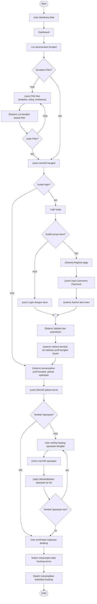

# Flowchart Booking Servis Bengkel

Dokumen ini adalah konversi dari flowchart alur pengguna untuk memesan servis di bengkel beserta penambahan sparepart.

## Diagram

## Deskripsi Alur

### 1. Pencarian Bengkel
1. **Start** — alur dimulai.
2. User membuka web.
3. Sistem menampilkan **Dashboard**.
4. Sistem menampilkan **list rekomendasi bengkel**.
5. **Keputusan: Gunakan Filter?**
   - **Ya** → user memilih filter (terdekat, rating, atau kombinasi) → sistem menampilkan list bengkel sesuai filter → **Keputusan: Ubah Filter?**
     - **Ya** → kembali ke pemilihan filter.
     - **Tidak** → lanjut ke pemilihan bengkel.
   - **Tidak** → langsung lanjut ke pemilihan bengkel.
6. User memilih bengkel.

### 2. Autentikasi
7. **Keputusan: Sudah login?**
   - **Ya** → langsung menuju tampilan profil bengkel (langkah 13).
   - **Tidak** → menuju **Login page**.
8. **Keputusan: Sudah punya akun?**
   - **Ya** → user login dengan akun.
   - **Tidak** → sistem menampilkan Register page → user input username & password → sistem submit akun baru.
9. Kedua jalur bertemu kembali pada satu titik (merge).
10. Sistem melakukan **validasi dan autentikasi**.
11. Sistem **redirect** kembali ke halaman profil bengkel tujuan.

### 3. Pemilihan Jadwal
12. (jalur login langsung & hasil redirect bertemu di sini)
13. Sistem menampilkan **profil bengkel, jadwal, dan sparepart**.
14. User memilih **jadwal servis**.

### 4. Penambahan Sparepart
15. **Keputusan: Tambah Sparepart?**
    - **Tidak** → langsung ke konfirmasi booking.
    - **Ya** →
      1. User melihat katalog sparepart bengkel.
      2. User memilih sparepart.
      3. User menambahkan sparepart ke list.
      4. **Keputusan: Tambah Sparepart lain?**
         - **Ya** → kembali ke katalog sparepart.
         - **Tidak** → lanjut ke konfirmasi booking.

### 5. Konfirmasi & Selesai
16. User mengonfirmasi **ringkasan booking**.
17. Sistem **menyimpan data booking servis**.
18. Sistem **menampilkan bukti/tiket booking**.
19. **END**.

## Ringkasan Titik Keputusan

| Keputusan | Ya | Tidak |
|---|---|---|
| Gunakan Filter? | Pilih filter | Langsung pilih bengkel |
| Ubah Filter? | Kembali pilih filter | Pilih bengkel |
| Sudah login? | Tampilkan profil bengkel | Login page |
| Sudah punya akun? | Login dengan akun | Register page |
| Tambah Sparepart? | Lihat katalog sparepart | Konfirmasi booking |
| Tambah Sparepart lain? | Kembali ke katalog | Konfirmasi booking |

## Aktor

- **User** — membuka web, memilih filter/bengkel/jadwal/sparepart, login/register, konfirmasi booking.
- **Sistem** — menampilkan list, validasi autentikasi, redirect, menyimpan booking, menampilkan tiket.
